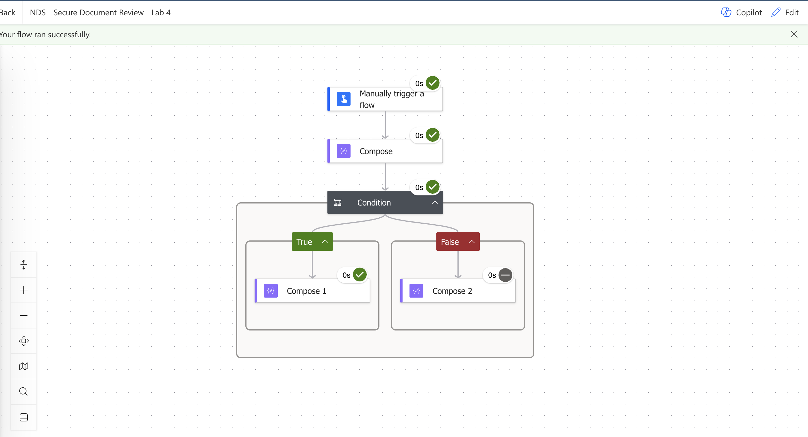
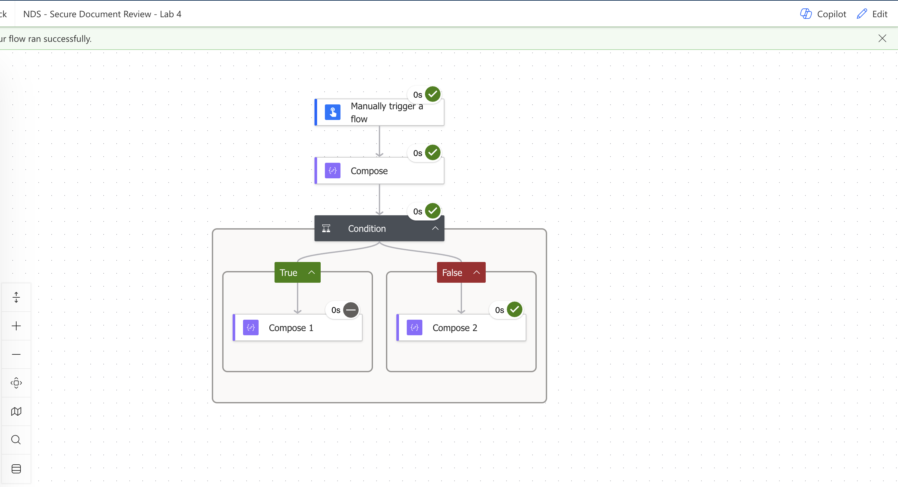
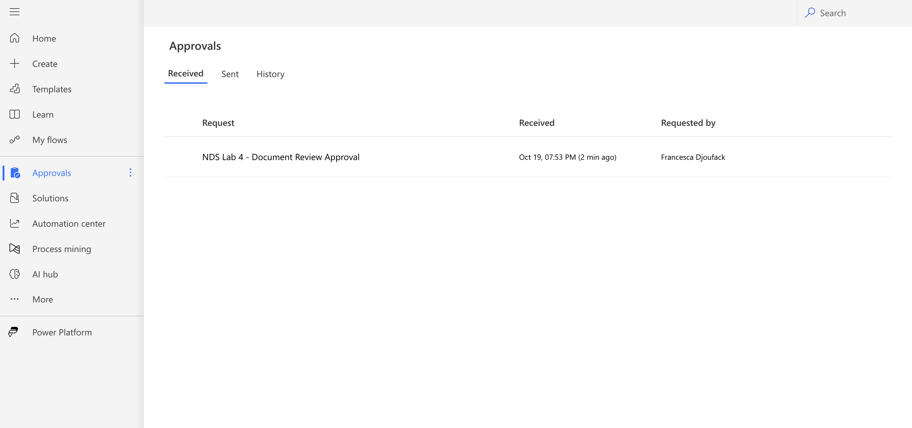
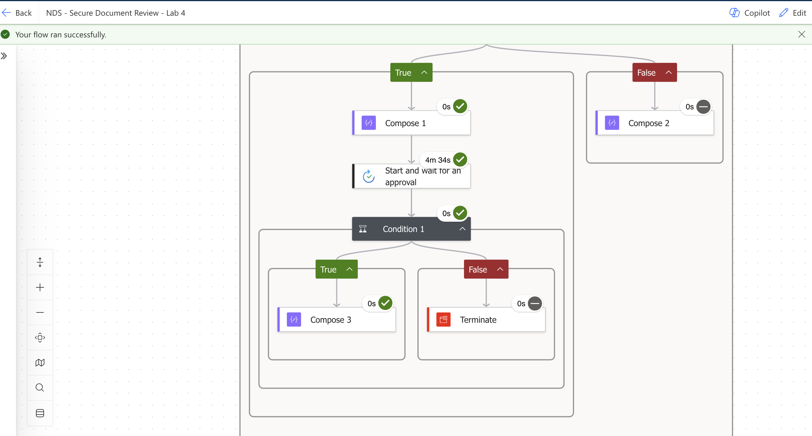
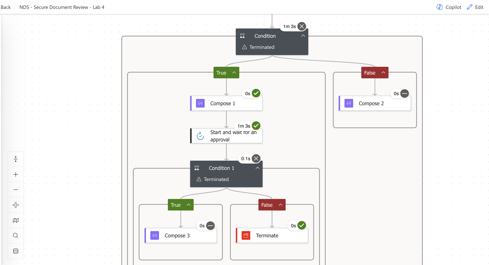
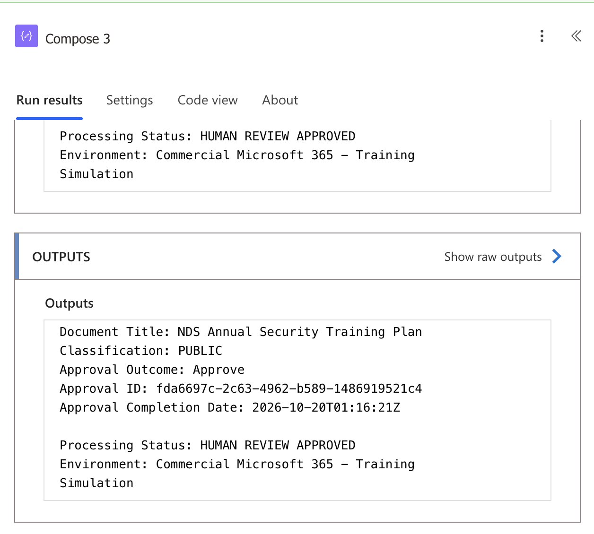
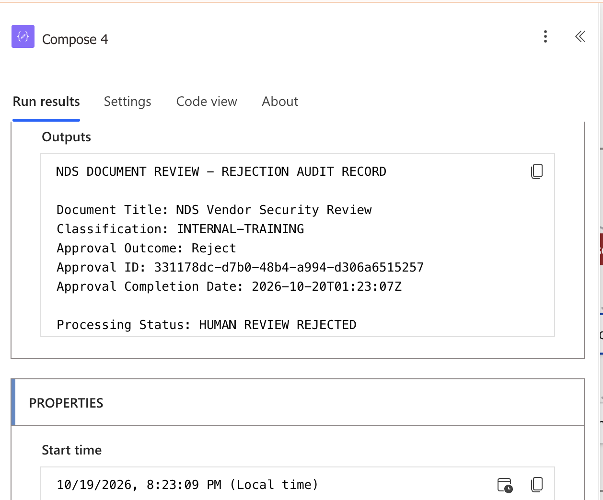
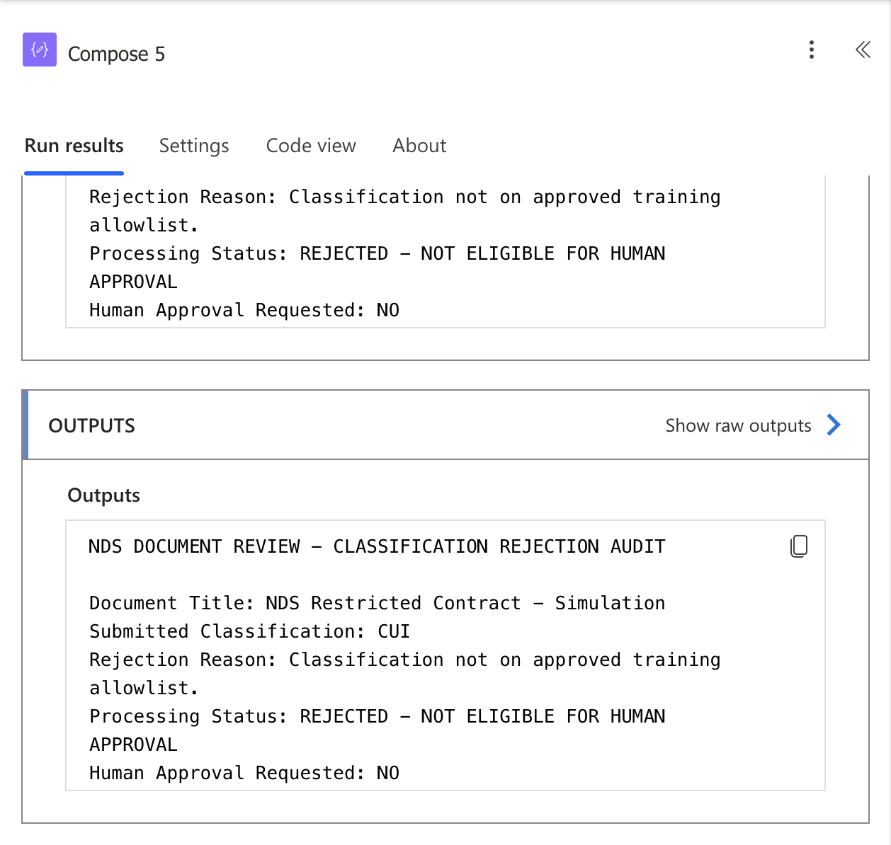

# Microsoft GCC High Solution Readiness Lab

**Power Automate | Human-in-the-Loop Automation | Security Architecture | Government Cloud Readiness**

## Project overview

For fictional contractor Northstar Defense Solutions (NDS), I built and tested a document-review workflow in a **commercial Microsoft 365 education environment** and designed a proposed **Microsoft 365 GCC High** deployment architecture.

**Scope distinction:** The Power Automate implementation is hands-on. GCC High is a design/readiness assessment only; no GCC High tenant was accessed, and no real CUI or ITAR-controlled information was used.

## Commercial hands-on prototype

Power Automate flow: **NDS - Secure Document Review - Lab 4**

- Manual trigger accepts fictional document title and user-supplied classification.
- Allowlist routes `PUBLIC` and `INTERNAL-TRAINING` to human approval.
- `CUI`, `UNKNOWN`, and other labels follow classification rejection, audit-style Compose output, and Terminate.
- Approval connector sends request to an assigned reviewer and waits for an explicit response.
- Approved outcome follows the approved branch; rejected outcome produces a Compose audit output and terminates.
- Audit-style outputs include document title, submitted classification, outcome, approval ID, and completion date.

**Not implemented:** Actual document ingestion, trusted classification inspection, SharePoint integration, a durable audit-log destination, approval timeout handling, independent reviewer authorization, AI calls, and GCC High deployment.

## Observed prototype validation

| Scenario | Observed result |
|---|---|
| PUBLIC label | Allowlisted branch |
| INTERNAL-TRAINING label | Allowlisted branch |
| CUI label | Classification rejection |
| UNKNOWN label | Classification rejection |
| Human approves | Approved branch executes |
| Human rejects | Termination executes |
| Approved decision metadata | Dynamic Compose output populated |
| Rejected decision metadata | Dynamic Compose output populated |
| Classification denial | Compose record followed by Terminate |

Tests were performed in commercial Power Automate using fictional data. Classification here is based on user-entered text, not verified document sensitivity.

## Proposed government-cloud solution

See the [architecture and data-flow diagram](architecture/gcc-high-solution-architecture.md).

- [GCC High service-readiness assessment](docs/gcc-high-service-readiness.md)
- [Security readiness checklist](docs/gcc-high-security-checklist.md)
- [Deployment validation plan](docs/gcc-high-deployment-validation.md)
- [Operational runbook](docs/gcc-high-operational-runbook.md)

The target design evaluates Entra Government identity, GCC High SharePoint storage, Power Automate Government, human authorization, data loss prevention, governed logging, connector policies, and trust boundaries. External AI requires separate assessment and approval and was not connected to the prototype.

## Evidence

Eight screenshots from the commercial Power Automate training workflow are provided below. These demonstrate workflow execution rather than GCC High deployment.

### Classification allowlist — PUBLIC

### Classification rejection — CUI

### Human approval request delivered

### Human approval accepted

### Human approval rejected

### Approved decision audit

### Rejected decision audit

### Classification rejection audit and termination

## Production readiness

**NOT APPROVED FOR PRODUCTION.** No target-tenant controls, connector compatibility, GCC High security validation, compliance certification, or deployment authorization have been established.
