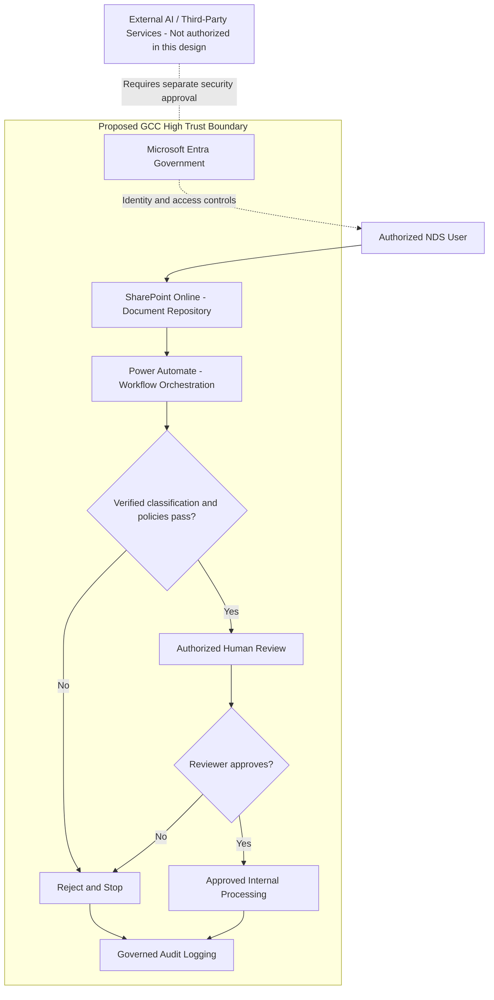

# NDS GCC High Solution Architecture

**Status:** Proposed architecture, not deployed. **Implementation evidence:** commercial Power Automate training prototype.

## Proposed document review

## Data flow and trust boundaries

1. Authenticated user submits a document to the proposed SharePoint repository.
2. Power Automate initiates workflow and verifies eligibility.
3. Classification and policy failures are rejected and logged.
4. Eligible submissions require an authorized reviewer.
5. Rejected reviews are logged and terminated.
6. Approved reviews allow only separately authorized downstream actions.
7. Audit events are recorded in a governed logging destination.

## Design controls

Least privilege; verified sensitivity classification; data policies; government-cloud endpoint and connector compatibility; authorized reviewers; timeout and exception handling; retention and monitoring; no external AI transfer without explicit authorization.

## Implementation boundary

The working commercial prototype uses a manual trigger, user-supplied labels, approval actions, and Compose audit records. SharePoint integration, verified classification, durable audit storage, and all GCC High specific deployments are proposed only. No actual CUI or ITAR-controlled data was used.
